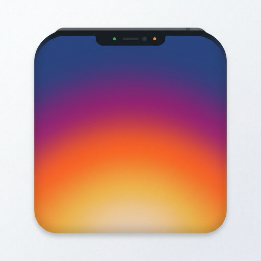

<div align="center">



# MyOwnNotch

**Transforme o notch do seu Mac em uma ilha interativa.**
Player de música, timer, bateria, clima, terminal, Claude e muito mais, tudo a um hover de distância.


</div>

---

## Sobre

O **MyOwnNotch** é um app nativo para macOS, escrito em SwiftUI, que transforma o notch da tela em uma "ilha" dinâmica, inspirada na Dynamic Island do iPhone. Ela fica discreta quando não está em uso, mostra informações compactas (como a música que toca ou o tempo restante do timer) e se expande para um painel completo quando você precisa interagir.

Roda como app de barra de menus, sem ícone no Dock, e flutua acima da menu bar.

## Recursos

| Módulo | O que faz |
| --- | --- |
| 🎵 **Player de música** | Controla Spotify e Apple Music: capa, faixa, progresso, volume e visualizador de áudio. |
| 🎧 **Spotify Connect** | Login OAuth (PKCE), fila "Playing Next", curtir faixa e troca de dispositivos e saída de áudio do Mac. |
| ⏱ **Timer Focus/Break** | Régua deslizante para escolher os minutos e barra de marcas que se apagam durante a contagem. Durações e som configuráveis nos Ajustes. |
| 🔋 **Bateria** | Nível, estado de carga e detalhes de saúde (IOKit). Some em Macs sem bateria. |
| 🌤 **Clima** | Temperatura, sensação térmica, umidade, vento, máx/mín e previsão de 3 dias, com busca por cidade ou local padrão nos Ajustes. |
| 💻 **Terminal** | Shell de login real em PTY (SwiftTerm). A sessão continua viva ao trocar de aba. |
| 🗂 **Bandeja de arquivos** | Solte arquivos no notch para guardá-los e arraste-os de volta para qualquer lugar. Botão **Comprimir (.zip)** na barra (todos os itens) e "Comprimir" no menu de contexto de cada item. |
| 📋 **Clipboard** | Histórico da área de transferência (texto, links, cores, imagens e arquivos) só em memória, com busca, fixar, remover e arrastar de volta. Clique copia novamente; itens de gerenciadores de senha são ignorados. Desligável nos Ajustes. |
| ☕ **Manter acordado** | Pílula na aba Bateria que impede o Mac de dormir; aparece nas asas do notch enquanto ativa. |
| ⇪ **Caps Lock** | Indicador nas laterais do notch quando o Caps Lock está ligado (desligável nos Ajustes). |
| 🪟 **Estilos de vidro** | Dynamic Glass (preto na câmera, derretendo em vidro), Liquid Glass e Preto, mais cor de destaque configurável. Fica sólido em Modo de Pouca Energia. |
| 👆 **Swipe para pular faixa** | Dois dedos no trackpad sobre o notch recolhido: esquerda = próxima, direita = anterior (com música tocando). |
| ✨ **Claude** | Converse com o Claude pelo CLI `claude` já instalado e logado (sem chave de API). Haiku, Sonnet ou Opus, com modo agente opcional. |
| 📊 **Crypto / Cotações** | Bitcoin, dólar e euro em BRL com variação e minigráfico de 30 dias. |
| 🐙 **GitHub** | Gráfico de contribuições público de um usuário (sem token): hoje, ano e sequência. |
| 📅 **Calendário** | Próximos eventos e botão para entrar na videochamada (Meet, Zoom, Teams, FaceTime, Webex). Opcional, pede permissão. |
| 📈 **Monitor do sistema** | CPU, RAM, GPU e armazenamento. Só atualiza enquanto a aba está visível. |
| 🎥 **Indicador de câmera/mic** | Mostra nas laterais do notch quando câmera ou microfone estão em uso. Não captura nada e não pede permissão de câmera/mic. |
| 🔊 **HUD de volume** | Barra de volume ao mudar o volume do sistema (desligável nos Ajustes). |
| ✨ **Live Activities** | Atividades nas "asas" do notch recolhido, por prioridade: câmera/mic, timer terminando, reunião, Caps Lock, timer, música, carregando, manter acordado. Clique para abrir o módulo. |

## Atalhos

### Menu da barra de menus

| Atalho | Ação |
| --- | --- |
| `M` | Player de música |
| `T` | Timer |
| `B` | Bateria |
| `W` | Clima |
| `X` | Terminal |
| `F` | Bandeja de arquivos |
| `C` | Claude |
| `K` | Crypto |
| `G` | GitHub |
| `S` | Monitor do sistema |
| `L` | Calendário |
| `V` | Clipboard |
| `Esc` | Recolher o notch |
| `⌘,` | Ajustes |
| `Q` | Sair |

### Com o notch expandido

| Atalho | Ação |
| --- | --- |
| `⌘1` ... `⌘9` | Ir para a aba N (na ordem das abas visíveis) |
| `⌘←` / `⌘→` | Aba anterior / próxima (desativado em Terminal, Claude, Clima e GitHub, onde é "início/fim da linha") |
| `←` / `→` | Aba anterior / próxima (exceto nos módulos com campo de texto) |
| Swipe horizontal (trackpad) | Aba anterior / próxima |

### Com o notch recolhido

| Gesto | Ação |
| --- | --- |
| Swipe horizontal de dois dedos sobre o notch | Próxima / faixa anterior (música tocando) |
| `Esc` | Recolher (exceto em Terminal e Claude, que ficam abertos; use o ✕) |

## Ajustes

Abra pelo menu (`⌘,`). Opções: abrir ao iniciar sessão (SMAppService), atividades ao vivo, Caps Lock no notch, histórico da área de transferência, swipe para pular faixa, HUD de volume, aparência (estilo de vidro, cor de destaque, sólido em pouca energia), módulos visíveis (oculte o que não usa; se a aba ativa for ocultada o notch troca para a primeira visível), durações de foco/pausa e som do timer, local padrão do clima e calendário.

## Permissões

- **Automação** (Spotify / Música): necessária para ler e controlar a reprodução via AppleScript. Se negada, o módulo de mídia mostra um aviso; reative em Ajustes do Sistema > Privacidade e Segurança > Automação.
- **Calendários** (opcional): só é pedida ao ativar "Mostrar próxima reunião" nos Ajustes.
- Câmera e microfone **não** são solicitados: o indicador só lê o estado "em uso" dos dispositivos.

## Segurança do modo agente (Claude)

- Cada pergunta roda `claude -p` com um **diretório de trabalho dedicado** (configurável); o Claude só opera ali.
- Ferramentas permitidas: no modo normal apenas `Read`, `Glob`, `Grep` (somente leitura). No modo agente: `Read`, `Glob`, `Grep`, `Write` e `Edit`, com escrita/edição restrita ao diretório de trabalho (regras `Edit(./**)`) e `--permission-mode acceptEdits`. O único comando permitido é `ls`: **sem git, sem shell** e **sem acesso à web**.
- Configurações do projeto (`.claude/`, `.mcp.json`) são ignoradas: o CLI roda com `--setting-sources user` e `--strict-mcp-config`, para que um repositório não injete hooks, permissões ou servidores MCP.
- Diretórios sensíveis (home, `/`, `~/Library`) são recusados como diretório de trabalho.
- O texto do usuário é passado após `--`, nunca interpretado como opção.
- Escolha um diretório de trabalho que não contenha segredos.

## Requisitos

- macOS 27 ou superior (deployment target atual do projeto)
- Xcode com suporte a SwiftUI
- *Opcional:* [Claude Code](https://claude.com/claude-code) instalado e logado, para o módulo Claude
- *Opcional:* um Client ID de app Spotify próprio, para fila, curtir faixa e dispositivos

## Como rodar

```bash
git clone <url-do-repositorio>
cd MyOwnNotch
open MyOwnNotch.xcodeproj
```

1. Aguarde o Xcode resolver o pacote [SwiftTerm](https://github.com/migueldeicaza/SwiftTerm) (Swift Package Manager).
2. Selecione o scheme **MyOwnNotch** e rode com `⌘R`.
3. Na primeira execução, autorize o controle do Spotify/Música quando o macOS pedir (permissão de Automação).

> **Sobre o App Sandbox:** ele está desativado de propósito (veja `MyOwnNotch.entitlements`). Isso é necessário para a janela flutuar acima da menu bar, controlar outros apps via AppleScript e ler a bateria via IOKit.

## Estrutura do projeto

```
MyOwnNotch/                    # app
├── MyOwnNotchApp.swift        # Entrada do app
├── AppDelegate.swift          # Menu da barra, janela, mouse, telas
├── NotchWindow.swift          # Janela flutuante sobre a menu bar
├── NotchGeometry.swift        # Medidas do notch, tamanhos da ilha, NotchShape
├── NotchViewModel.swift       # Estado central, pollers (por visibilidade), clima, crypto, sleep/wake
├── NotchContainerView.swift   # Container, abas, atalhos e swipe
├── Contracts.swift            # LoadState, LiveActivity, SettingsKey, CalendarEvent
├── Theme.swift                # Tokens de design e StateView
├── LiveActivityViews.swift    # Asas do notch recolhido
├── SettingsView.swift         # Tela de Ajustes
├── MediaControl.swift         # Spotify / Apple Music (AppleScript)
├── SpotifyService.swift       # OAuth PKCE e Web API do Spotify
├── GitHubService.swift        # Contribuições do GitHub
├── CalendarService.swift      # EventKit
├── PrivacyMonitor.swift       # Câmera/mic em uso (CoreMediaIO / CoreAudio)
├── PowerMonitor.swift         # Eventos de energia (IOPS)
├── SystemAudioVolume.swift    # Volume do sistema (CoreAudio)
├── AgentSession.swift         # Integração com o CLI do Claude
├── TerminalSession.swift      # Terminal em PTY (SwiftTerm)
├── ClipboardViews.swift       # Histórico da área de transferência
├── *Views.swift               # Interface de cada módulo
└── SharedComponents.swift     # Componentes de UI reutilizáveis
MyOwnNotchTests/               # testes unitários (XCTest)
```

## Testes

```bash
xcodebuild -project MyOwnNotch.xcodeproj -scheme MyOwnNotch -configuration Debug \
  CODE_SIGNING_ALLOWED=NO test
```

## Tecnologias

- **SwiftUI** e **AppKit** para a interface e a janela do notch
- **Combine** para estado reativo
- **IOKit** para bateria, **EventKit** para o calendário, **CoreAudio/CoreMediaIO** para volume e privacidade, **Network** e **CryptoKit** para o OAuth do Spotify, **Keychain** para os tokens
- **SwiftTerm** para o terminal
- **wttr.in** (clima) e **AwesomeAPI** (cotações)

## Status

Projeto pessoal em desenvolvimento ativo.

---

<div align="center">
<br/>
<sub>Feito com SwiftUI para o seu notch.</sub>
</div>
